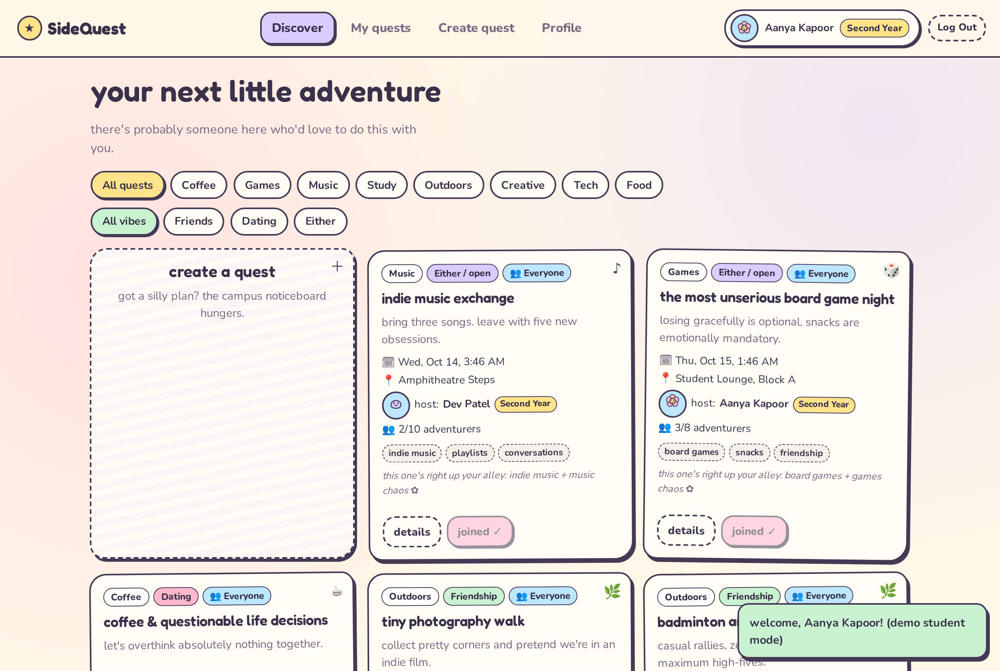
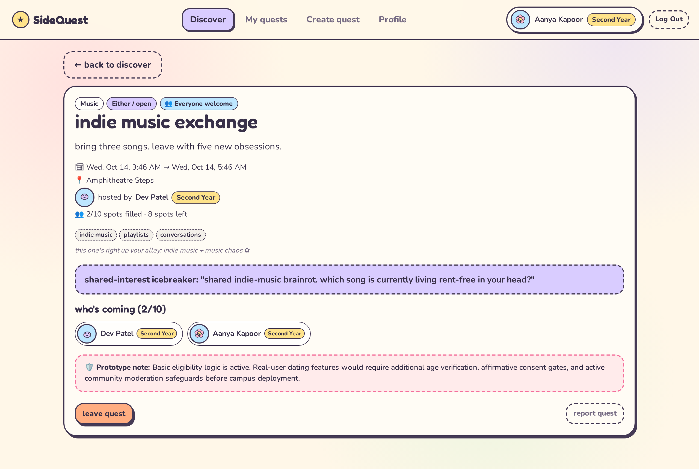
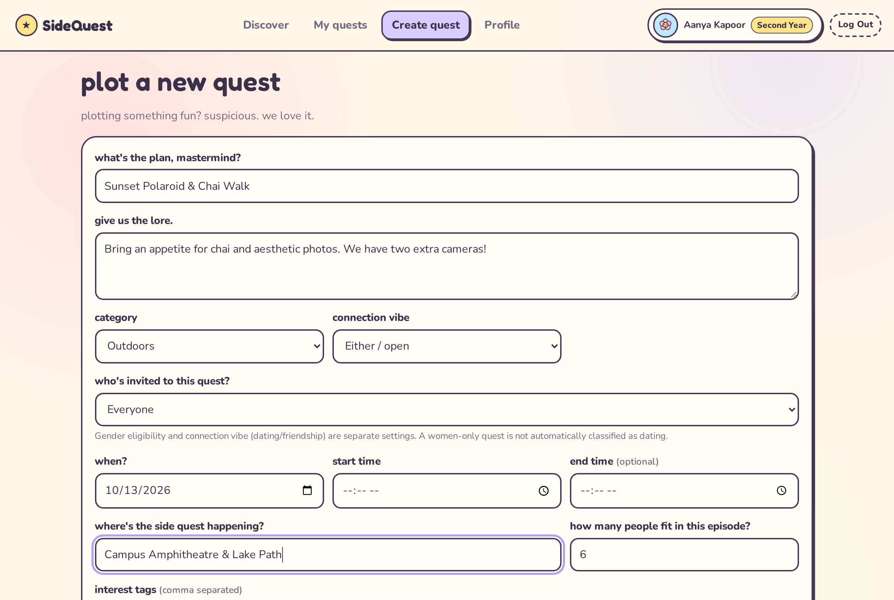
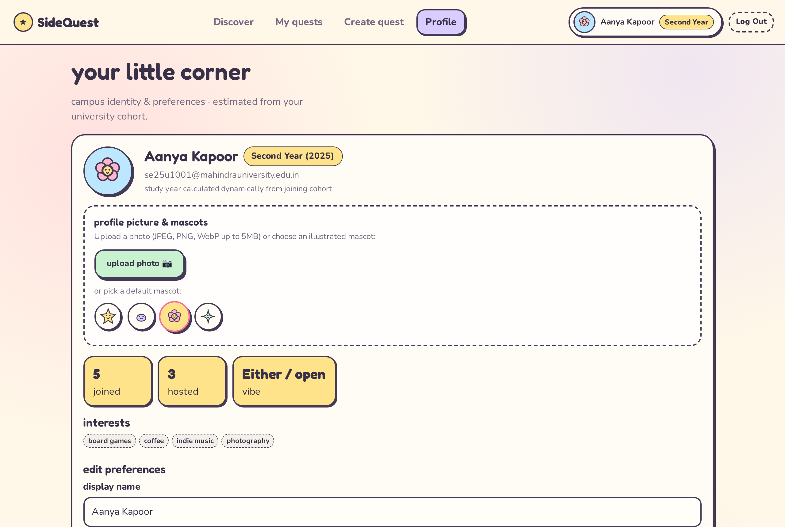
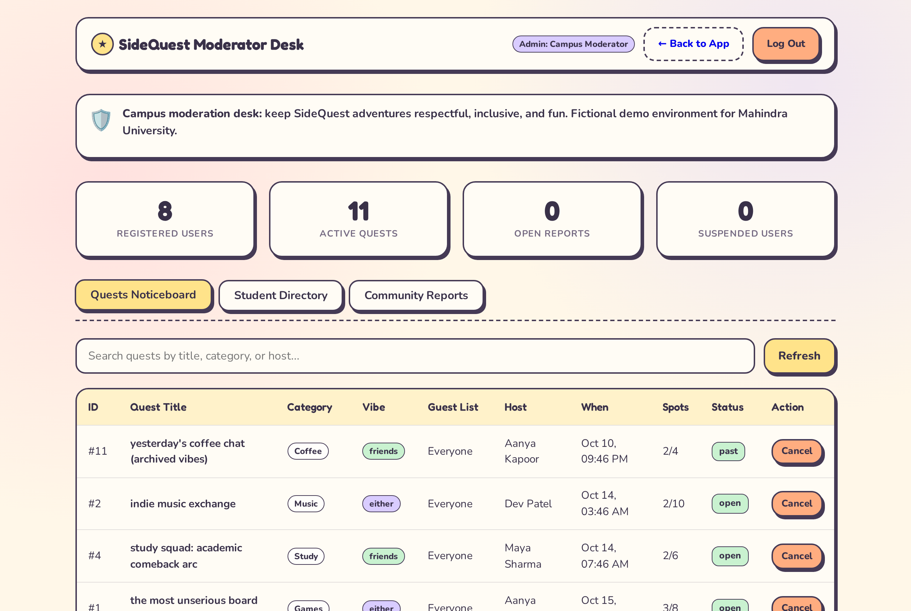

# SideQuest · MU

> **"Don't just find people. Find your next little adventure."**

SideQuest is a polished, realistic campus social discovery web app for Mahindra University students. It helps students discover activities, meet new people, make friends, and find romantic connections through shared experiences — rather than endless profile swipes.


---

## ✦ Table of Contents

1. [Problem & Solution](#-problem--solution)
2. [Visual Identity & Scrapbook Aesthetic](#-visual-identity--scrapbook-aesthetic)
3. [Key Features](#-key-features)
4. [University Cohort & Study Year Calculation](#-university-cohort--study-year-calculation)
5. [Gender & Dating Intent Separation](#-gender--dating-intent-separation)
6. [Technology Stack](#-technology-stack)
7. [Screenshots](#-screenshots)
8. [Quick Start & Setup Instructions](#-quick-start--setup-instructions)
9. [Fictional Demo Accounts](#-fictional-demo-accounts)
10. [Administrator Panel & Moderation](#-administrator-panel--moderation)
11. [Known Limitations & Safety Safeguards](#-known-limitations--safety-safeguards)

---

## ✦ Problem & Solution

### The Problem
Making friends or discovering romance at university is often awkward and high-pressure. Traditional social apps prioritize surface-level swiping where intent is murky. Students want low-friction, natural ways to connect over something concrete to *do*.

### The Solution
SideQuest puts **activities at the center of campus discovery**. Students post and join small campus quests — board game nights, coffee chats, study squads, photo walks, coding circles — with transparent connection vibes (Friendship, Dating, or Either). Joining an activity never implies unwanted romantic assumptions.

---

## ✦ Visual Identity & Scrapbook Aesthetic

SideQuest embraces a playful **indie game crossed with a student journal** visual system:

- **Warm Cream Backgrounds**: `--cream: #FFF7E8`, `--paper: #FFFCF5`
- **Pastel Palette**: Pastel pink (`#FFB7CE`), lavender (`#D9CCFF`), mint (`#C9F2D0`), butter yellow (`#FFE38A`), sky blue (`#BDE6FF`), and peach
- **Tactile Cards**: Rounded cards with playful outlines (`border: 2.5px solid #453A55`) and offset shadows (`box-shadow: 3px 4px 0 #453A55`)
- **Typography**: Display headings in **Fredoka** paired with readable body text in **Nunito**
- **Doodles & Mascots**: Illustrated stickers (✦, ✿, ★, ♡, ✧, ❀), paper tape, floating stars, and animated campus mascots
- **Whimsical Dialogues**: Reusable in-app speech bubbles and toast notifications instead of browser alerts
- **Accessible & Mindful**: Full keyboard navigation, focus rings (`:focus-visible`), and respects `prefers-reduced-motion`

---

## ✦ Key Features

- **Authentication & Accounts**: Dedicated `/login` and `/register` portal with `@sdheeraj.is-cool.dev` campus email validation, password hashing with Werkzeug, OTP verification flow (`123456` 1-click auto-fill in demo mode), forgot password modal, and 1-click demo student switcher.
- **Dynamic University Study Year & Branch**: Automatically extracts cohort year and engineering branch from email patterns (e.g. `se25ucse100` -> `Second Year · CSE`, `se26uecm024` -> `First Year · ECM`, `se25uaid004` -> `Second Year · AI & DS`, `se24umech006` -> `Third Year · Mechanical`).
- **Attendee Privacy & Tactile Hover Cards**: In "Who's coming" on quest details, attendee privacy is protected by displaying only their first name or custom display name. Hovering or tapping reveals an adorable popover card with their details, shared interests, and a link to their public profile.
- **Public Student Profile Pages (`/user/<id>`)**: Each student gets an individual scrapbook profile page showcasing their avatar, branch badge, bio, connection vibe, interests, and hosted/joined quests. Students can customize their `profile_visibility` (`public`, `first_name_only`, `minimal`).
- **Profile Pictures & Mascots**: Upload device images (PNG, JPEG, WebP up to 5MB, validated and resized to safe WebP thumbnails) or choose from 4 illustrated SVG mascot avatars (`star`, `blob`, `flower`, `spark`).
- **Gender & Dating Preferences**: Profiles include optional gender (`Woman`, `Man`, `Non-binary`, `Self-describe`, `Prefer not to say`). Activity creation supports guest list eligibility (`Everyone`, `Women only`, `Men only`, `Non-binary only`, `Custom`), enforced securely in the backend.
- **Activity Feed & Filtering**: Discover quests with real-time category filters (Coffee, Games, Music, Study, Outdoors, Creative, Tech, Food) and vibe filters (Friends, Dating, Either).
- **Join/Leave & Capacity**: Real-time spots tracking, duplicate-join blocking, and capacity enforcement.
- **Transparent Recommendations**: Ordinary, deterministic Python scoring based on shared interests, category preferences, and connection alignment — zero external AI black boxes.
- **Shared-Interest Icebreakers**: Contextual conversation starters generated from actual overlapping interests (e.g., *"you both love photography. who gets to be the designated photographer and who gets to look mysterious?"*).
- **My Quests Log**: Track upcoming adventures, hosted quests, and past campus memories.
- **Campus Moderation Desk (`/admin`)**: Administrative dashboard to monitor users, edit student profiles, remove quests, suspend accounts, review reports, and perform a **5-warning stage mass database reset**.

---

## ✦ University Cohort & Branch Calculation

University email prefixes indicate student joining cohorts and branch departments. SideQuest computes academic year and branch dynamically:

$$\text{Current Academic Year} = \begin{cases} \text{Year}, & \text{if Month} \ge \text{Start Month (configurable, default July)} \\ \text{Year} - 1, & \text{otherwise} \end{cases}$$

$$\text{Study Year Number} = \text{Current Academic Year} - \text{Cohort Year} + 1$$

Branch codes mapped automatically:
eg:
- `ucse` $\to$ **CSE** (Computer Science & Engineering)
- `uecm` $\to$ **ECM** (Electronics & Computer Engineering)

Examples during the 2026 academic year:
- **`se26uecm024`**: First Year · ECM (joined 2026)
- **`se25ucse100`**: Second Year · CSE (joined 2025)
- **`se23ucse005`**: Fourth Year · CSE (joined 2023)
- **`se22` or earlier**: Handled gracefully as graduated (no impossible study year shown)
- **Staff / Unrecognized format**: Gracefully displayed without cohort badge

Implemented as a reusable Python module in `year_utils.py` and unit-tested in `tests/test_features.py`.

---

## ✦ Gender & Dating Intent Separation

Gender eligibility and connection vibe are separate settings:
1. **Connection Vibe**:
   - `Friendship`: Socializing, study groups, casual hangouts
   - `Dating`: Explicit romantic discovery
   - `Either`: Open to meeting people and seeing what develops
2. **Guest List Eligibility**:
   - `Everyone`
   - `Women only`
   - `Men only`
   - `Non-binary participants only`
   - `Custom selection`

**Privacy & Security Rules:**
- A women-only quest is **not** automatically classified as dating.
- Eligibility is enforced on the server (`db.join_activity()`), not just by disabling frontend buttons.
- Ineligible students receive a clean notice without exposing any student's private profile attributes.

---

## ✦ Technology Stack

- **Backend**: Python 3.13 / 3.14, Flask, SQLite3, Werkzeug (password hashing & secure uploads), Pillow (image validation & thumbnail processing)
- **Frontend**: Semantic HTML5, Custom CSS with CSS variables, Vanilla JavaScript (ES6+), SVG illustrations
- **Persistence**: SQLite with foreign keys and automatic seeding (`sidequest.db`)
- **Containerization**: Docker & Docker Compose (`python:3.13-slim` base image)
- **Testing**: `pytest` test suite with 18 automated tests covering auth, branch & year parsing, image uploads, eligibility, privacy popovers, admin student editing, and mass reset.

---

## ✦ Screenshots

### 1. Discover Feed

*Discover feed with whimsical scrapbook cards, category chips, study year & branch badges, and personalized shared-interest recommendation notes.*

### 2. Activity Details & Attendee Privacy

*Activity detail view featuring attendee roster showing first names for privacy, tactile hover cards with details, guest list eligibility rules, and shared-interest icebreaker.*

### 3. Create Activity with Guest List Rules

*Create quest form showing category selection, connection vibe, and backend-enforced guest list eligibility.*

### 4. Student Profile with Study Year & Branch

*Student profile displaying dynamic cohort year & branch badge (`Second Year · CSE`), custom photo upload, mascot avatars, and profile visibility settings.*

### 5. Moderator Admin Panel (`/admin`)

*Moderator desk with overview statistics, student editing modal, 5-stage warning mass reset, quest noticeboard management, and community reports.*

---

## ✦ Quick Start & Setup Instructions

### Option A: Local Development (Python Virtual Environment)

1. **Clone and enter the directory**:
   ```bash
   cd sidequest
   ```

2. **Create and activate a virtual environment**:
   ```bash
   python3 -m venv .venv
   source .venv/bin/activate
   ```

3. **Install dependencies**:
   ```bash
   pip install -r requirements.txt
   ```

4. **Initialize configuration (optional)**:
   ```bash
   cp .env.example .env
   ```

5. **Run the application**:
   ```bash
   python app.py
   ```
   Open your browser to: **[http://127.0.0.1:5050](http://127.0.0.1:5050)** (or **[http://127.0.0.1:5050/login](http://127.0.0.1:5050/login)**).

6. **Run automated test suite**:
   ```bash
   pytest -v
   ```

---

### Option B: Docker & Docker Compose

Start the application with a single command:
```bash
docker compose up --build
```
Access the application at **[http://localhost:5050](http://localhost:5050)**. SQLite database and uploaded pictures persist across container restarts in local directories.


---

## ✦ Known Limitations & Safety Safeguards

1. **Email Verification & OTP**: To facilitate instant hackathon demo testing, email verification and OTP delivery are not included.
2. **Attendee Privacy**: Attendees are identified on quests by first name only, with detailed popovers showing only public profile information.
3. **Dating Safeguards**: This prototype implements baseline gender eligibility filtering and connection labeling. In a real-world campus deployment, live dating discovery would require mandatory age verification, proactive affirmative consent gates, and direct human moderation before public launch.
4. **Storage & Infrastructure**: Data is stored locally in SQLite (`sidequest.db`) and uploaded images in `uploads/`. Production deployments would utilize cloud object storage (e.g. S3/GCS) and managed relational databases.