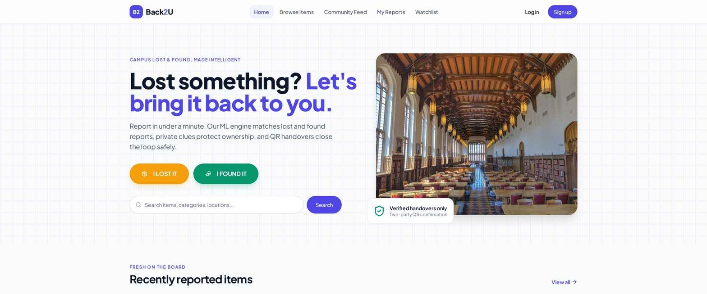
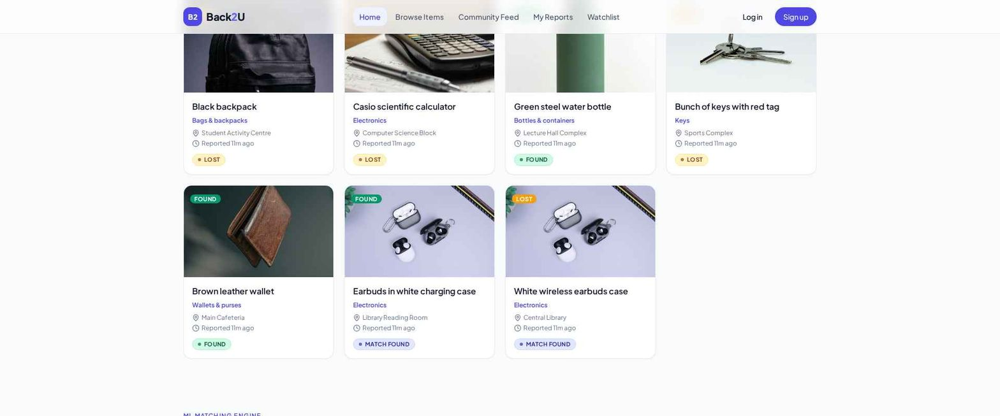
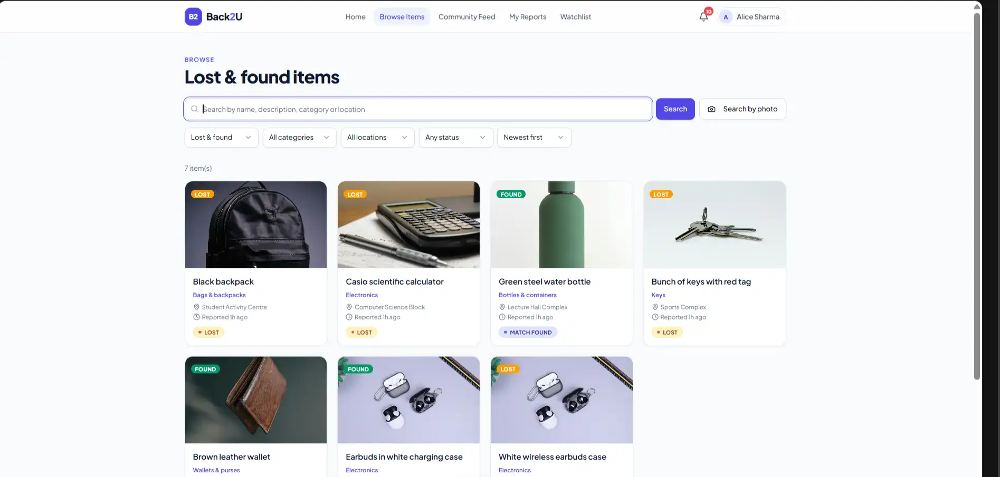
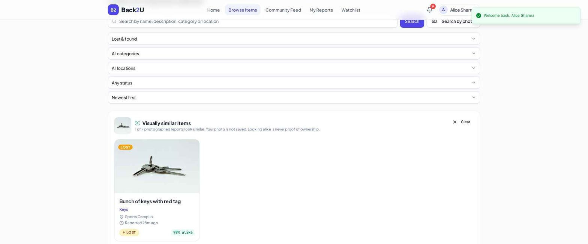
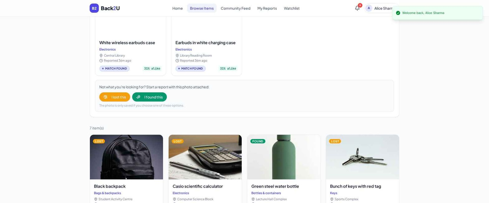
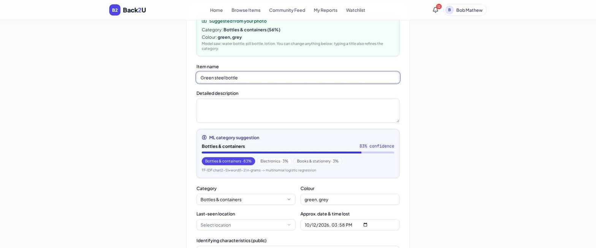
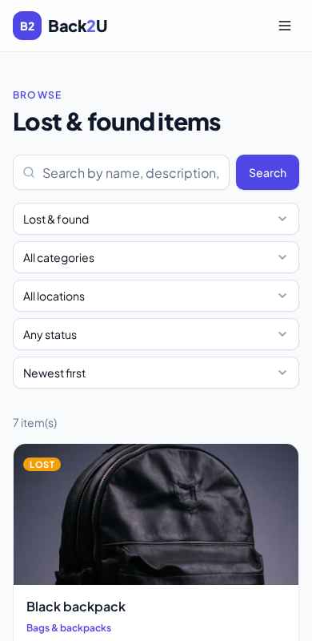

# Back2U — Intelligent Campus Lost & Found

## Team

**Team name:** MAVERICKS 1079

### Members

- Shantanu Srivastava — [@shantanusrivastava18](https://github.com/shantanusrivastava18)
- [@TRGsci](https://github.com/TRGsci)
- [@tanmaychakradhari](https://github.com/tanmaychakradhari)

## Problem

Every semester, students at Mahindra University lose everyday belongings such as ID cards, keys, earphones, water bottles, wallets, calculators and bags. The campus is large, with academic blocks, many hostels, dining halls, sports grounds and parking areas spread across it. A lost item can be in any of dozens of places.

Today there is no trustworthy, central way to get these items back. Students post on notice boards and WhatsApp groups, where messages get buried and the same item is reported many times. Anyone who finds something has no clear person to hand it to or way to reach the owner. These channels are also unsafe, because there is no way to check who really owns an item. A person can claim something that isn't theirs, and valuable things like phones, wallets and ID cards can end up with the wrong person. Nothing records who handed what to whom, so disputes are hard to settle.

The result is that:

- Owners lose items they could have recovered.
- Finders don't know what to do with what they find.
- Campus staff waste time answering the same questions.

## Solution

**Back2U** is a web app where students report items they lost or found, using the actual campus locations from the Mahindra University map (Library, Hostel 4A, Dining-1, Soccer Field and so on). It gives the campus one trusted place to report, match and return belongings.

How it works:

1. **Report.** A student chooses "I Lost It" or "I Found It" and fills in the title, description, colour, date and photos. The location is picked from the real campus locations. The app suggests a category from the text and can autofill details from a photo.
2. **Duplicate check.** Before a report is submitted, the app warns if a very similar report already exists.
3. **Smart matching.** Each lost report is compared with found reports and given a score from 0 to 100 with the reasons behind it. The score combines description similarity (35%), category (20%), colour and attributes (15%), location (15%) and date (15%). When both reports have photos, a photo comparison is included.
4. **Watchlists and notifications.** Students can save keywords, a category or locations and get an in-app notification when a matching report appears.
5. **Secure ownership claim.** A finder can add hidden details (for example a sticker or an engraving) that are never shown publicly. Someone claiming the item must answer questions about them, and claim attempts per day are limited.
6. **Safe handover.** After a claim is approved, a single-use QR code that expires in 30 minutes is created. Both people confirm the handover and the app produces a receipt. Items move through clear statuses: Lost, Found, Match Found, Claim Pending, Verification in Progress, Ready for Handover, Returned and Closed.
7. **Safety and administration.** Every user accepts a Responsible Use Policy and can report misuse. Admins can moderate reports, suspend or ban users, handle appeals, manage locations and review an audit log.

**Impact:** faster recoveries, fewer duplicate reports, verified ownership, a receipt and audit trail for every handover, and less repeated work for campus staff.

## Live demo and how to access it

- **Live app:** https://back2u1079.netlify.app
- **Backend API (Render):** https://hacktoberfest26-hackday-submissions.onrender.com/api/ (interactive API docs at `/docs`)

> **Note:** the backend runs on Render's free tier and sleeps when idle. The first request after a pause can take **30 to 60 seconds**. If the page seems stuck on first load or login, wait a minute and try again.

### How to log in

1. Open the live app and click **Log in / Sign up** in the top bar.
2. Pick one of the access options:
   - **Demo students (quickest):** on the login page, under "Hackathon demo mode", click **Alice**, **Bob** or **Carol**. No password is needed. Use two of them in separate browser windows (one normal, one private) to try the full lost-and-found flow between two people.
   - **Your own account:** click **Sign up**, enter your name, email and password, and accept the Responsible Use Policy.
   - **Admin:** the admin account is created from the server settings. The admin login is shared with reviewers on request and is not published here.

## How to use the app

**1. Report a lost item**
1. Log in and choose **Report Lost** (or open `/report/lost`).
2. Enter a title and description, and pick the colour and date.
3. Choose where you lost it from the list of Mahindra University campus locations (Library, Hostel 4A, Dining-1, Soccer Field and so on).
4. Optionally add photos. The app suggests a category and can autofill details from a photo.
5. If a similar report already exists, a duplicate warning appears before you submit.
6. Submit. The app immediately looks for found items that match.

**2. Report a found item**
1. Choose **Report Found** (or open `/report/found`).
2. Fill in the same details and pick where you found it.
3. Add private clues, such as a sticker or an engraving. They are never shown publicly and are only used to check the real owner.
4. Choose where you will keep the item (for example, the Infra Office, Library or Health Care Centre).

**3. Check your matches**
1. Open **My Reports** and click a report.
2. The matches panel lists possible matches with a score from 0 to 100 and the reasons behind it.

**4. Claim an item and verify ownership**
1. Open a found item from **Browse** or the community **Feed** and click **Claim**.
2. Answer the verification questions about details only the owner would know. Claim attempts per day are limited.
3. The finder reviews the claim and approves or rejects it.

**5. Hand over the item**
1. After approval, a handover page shows a single-use **QR code** that expires after 30 minutes.
2. At the meeting, the other person scans it at **Handover Scan** (`/handover/scan`), and both people confirm.
3. A **receipt** is created for both of you, and the item is marked as returned.

**6. Stay informed**
- **Watchlist:** save keywords, a category or locations to get a notification when a matching report appears.
- **Notifications:** the bell icon shows matches, claim updates and watchlist alerts.

**7. Admin tools** (admin account only, `/admin`)
Moderate reports, handle misuse reports and appeals, suspend or ban users, manage locations and review the audit log.

**Optional sample data:** to fill the app with sample reports, run `python seed.py` in `backend/` with the same `.env` values as the server. This is not needed to try the app.

## Screenshots

### Home page


The landing page explains the idea in one line and gives two big actions: **I LOST IT** and **I FOUND IT**. A search bar lets anyone look for items straight away, and the "Verified handovers only" badge points to the two-party QR confirmation that protects owners.

### Recently reported items


Fresh reports appear as cards with a **LOST** or **FOUND** label, the category, the location, how long ago it was reported, and a live status such as **MATCH FOUND** once the system has paired a lost and a found report.

### Browse and filter


The Browse page lists every report. Users can search by name, description, category or location, and narrow the list by type (lost or found), category, location, status and sort order. The **Search by photo** button is next to the search bar.

### Search by photo: strong match


A user uploads a photo of an item and the app compares it with photographed reports using an image model. Here a photo of keys finds the matching report at **98% alike**. The page reminds the user that the photo is not saved and that looking alike is never proof of ownership.

### Search by photo: weak match


When nothing is close, the app shows the nearest results with their low scores (here **31% alike**) and offers **I lost this** and **I found this** buttons to start a new report with the photo attached. The photo is only saved if the user chooses one of them.

### Report form with ML suggestions


When a photo is added, the app suggests a category and colours from it. As the user types a title, a text model (TF-IDF with logistic regression) suggests a category with a confidence score and shows the next most likely categories. Everything can be changed by the user. The last-seen location is picked from the Mahindra University campus locations.

### Mobile view


The interface is responsive, so students can report and search from their phones with the same filters and cards.

## Technologies used

- **Frontend:** React, Tailwind CSS, shadcn/ui, React Router
- **Backend:** Python, FastAPI, Uvicorn
- **Database:** MongoDB (Motor async driver)
- **Machine learning:** TF-IDF text similarity (matching, category prediction), MobileNetV2 via ONNX Runtime (photo similarity and photo autofill)
- **Security:** JWT authentication, bcrypt password hashing, hidden private clues, rate-limited claims, hashed single-use handover tokens, audit logging
- **Testing:** Pytest
- **AI / LLM tools:** Emergent, ChatGPT

## How to run

**Requirements:** Python 3.11, Node.js with Yarn, and a running MongoDB instance.

```bash
# 1. Clone the repository
git clone <your-repo-url>
cd <repo-folder>

# 2. Backend (runs on port 8001)
cd backend
pip install -r requirements.txt
cp .env.example .env
#   Open .env and fill in:
#   MONGO_URL, DB_NAME, JWT_SECRET, ADMIN_EMAIL, ADMIN_PASSWORD,
#   DEMO_PASSWORD, EMERGENT_LLM_KEY (needed for photo uploads)
uvicorn server:app --host 0.0.0.0 --port 8001

# 3. Optional: add sample items (run after the backend has started once)
python seed.py

# 4. Frontend (runs on port 3000) - open a second terminal
cd frontend
yarn install
#   Create frontend/.env with:
#   REACT_APP_BACKEND_URL=http://localhost:8001
yarn start

# 5. Run the tests (backend must be running)
cd backend
python -m pytest tests -q
```

Then open http://localhost:3000.

On startup the backend creates the admin account from `ADMIN_EMAIL` / `ADMIN_PASSWORD`, three demo students (`alice@campus.edu`, `bob@campus.edu`, `carol@campus.edu`, password from `DEMO_PASSWORD`) and the campus map locations. The login page has a demo-login button for the student accounts.

## Demo

- **Demo link:** https://back2u1079.netlify.app
- **Screenshots / video:** see the [Screenshots](#screenshots) section above

## Notes

- **Photo uploads** use Emergent's object storage, so they need a valid `EMERGENT_LLM_KEY`. Without it, the rest of the app still works but photo uploads fail.
- **Locations** come from the Mahindra University campus map. They are listed in `DEFAULT_LOCATIONS` in `backend/server.py` and synced to the database on startup. Admins can add more from the admin dashboard.
- **Photo similarity** is only a hint and is never treated as proof of ownership. Private clues are never used in matching.
- **Never commit `.env` files.** Use `backend/.env.example` as the template.
- **Indoor location (planned):** we will add an option to record the exact place inside a building. For example, the Ecole Centrale School of Engineering has many rooms and classrooms, so a user will be able to pick the exact room (building, floor and room) with pinpoint accuracy instead of only the building. This will make matching more precise and help owners find their items faster.
- **Future ideas:** email or SMS notifications, a mobile app, an interactive campus map for picking locations, integration with university ID login, and a better image model for detecting items like keys and ID cards.
