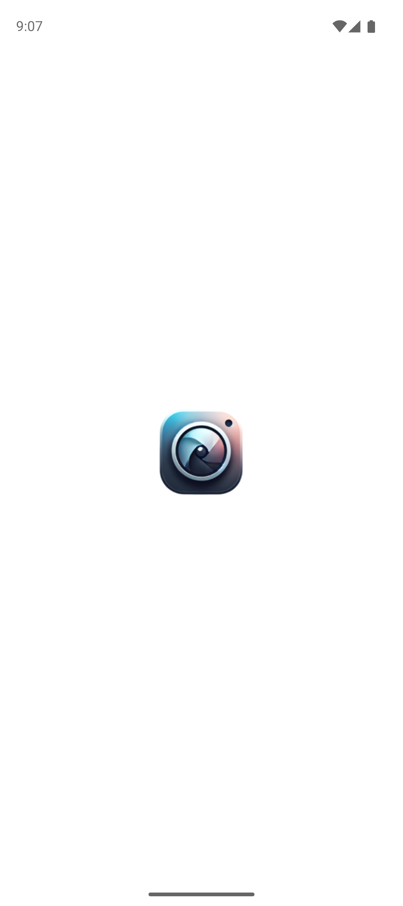
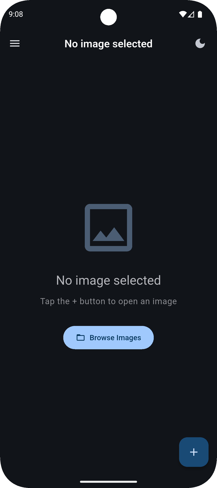
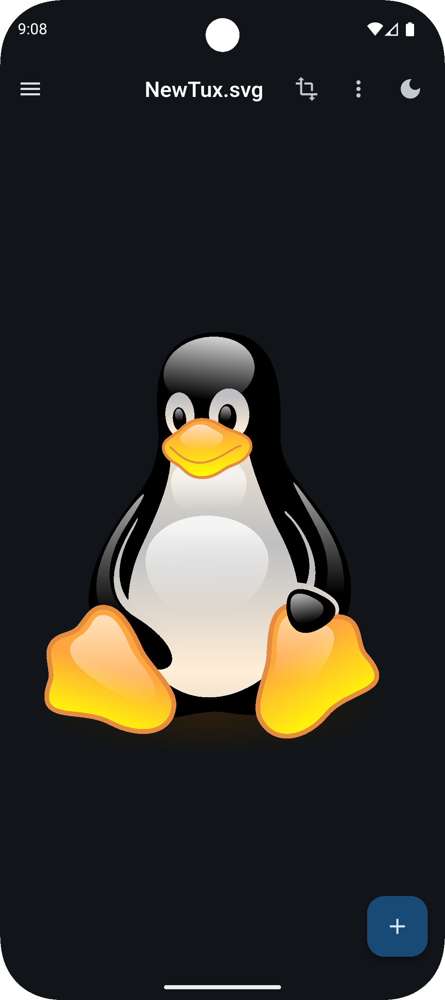
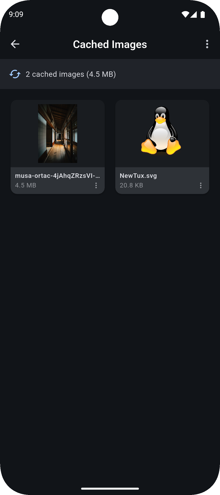
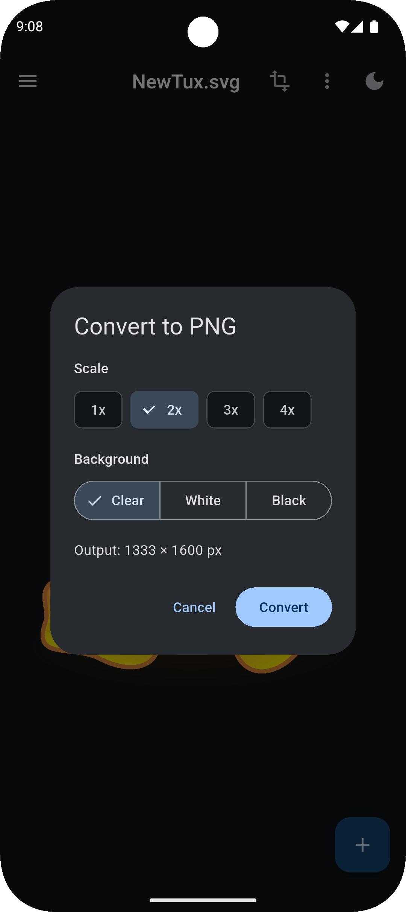

# Pix Glance (Mobile)

## Team Anonymous

**Members:**

* Archit Mishra
* Jyoti Sahu

## 🎯 The Problem

Many mobile users face the issue of not being able to easily open, view, or manage a wide variety of image formats seamlessly on their devices. Standard gallery apps often lack support for certain extensions (like SVG, HEIC, TIFF, etc.), making it frustrating to view downloaded or shared images.

## 💡 Our Solution

To solve this, we built **Pix Glance**, a versatile and powerful mobile application designed to view and manage almost any image format you throw at it. It features a clean UI, built-in image caching, and broad file support, ensuring you never struggle to view an image on your phone again.

## 🛠 Technologies Used

* **Framework:** [Flutter](https://flutter.dev/)
* **Language:** [Dart](https://dart.dev/)

---

## 📸 Screenshots

Here is a glimpse of the Pix Glance app in action:

<div align="center">
  
  
  
  
  
</div>
---

## 🖼 Supported Image Formats

Following are the images natively supported by `PixGlance`:

* `svg`
* `png`
* `jpg` / `jpeg`
* `gif`
* `webp`
* `tiff` / `tif`
* `bmp`
* `heic` / `heiv`
* `ico`

> *More formats will be added in future updates!*

---

## 🚀 Installation & Setup Instructions

### For End Users (APK Installation)

Four `apk` files have been provided for installation. You can choose according to your system's architecture:

* [arm64](https://github.com/architmishra-15/PixGlance/releases/download/apk/PixGlance-arm64-v8a.apk)
* [arm](https://github.com/architmishra-15/PixGlance/releases/download/apk/PixGlance-armeabi-v7a.apk)
* [x86_64](https://github.com/architmishra-15/PixGlance/releases/download/apk/PixGlance-x86_64.apk)

**How to find your mobile's architecture:**

* If you have `Termux` installed, paste the following command:
```bash
getprop ro.product.cpu.abi

```


* Alternatively, you can use apps like **CPU-Z** from the Play Store to view your phone's architecture.

**Universal APK (Easiest Method):**
If you don't know or can't figure out your architecture, you can download the universal [PixGlance.apk](https://github.com/architmishra-15/PixGlance/releases/download/apk/PixGlance.apk) which works on all devices.

> :warning: **Warning:** The size of this universal APK is quite a bit larger than the others (about 3x more).

### For Developers (Running from Source)

To clone and run this application locally, you'll need Git and Flutter installed on your computer.

1. **Clone the repository:**
```bash
git clone https://github.com/architmishra-15/PixGlance.git
cd PixGlance

```


2. **Install dependencies:**
```bash
flutter pub get

```


3. **Run the app:**
```bash
flutter run

```


---

## 📂 Code Structure

Here is an overview of the core application structure:

```bash
lib/
├── main.dart                     # App entry point
├── models/
│   └── cached_image.dart         # Data model for cached images
├── screens/
│   ├── home_screen.dart          # Main screen with image viewer
│   ├── image_view_screen.dart    # Full-screen image view
│   ├── cached_images_screen.dart # List of cached images
│   └── about_screen.dart         # About/info screen
├── services/
│   ├── theme_service.dart        # Theme management
│   ├── cache_service.dart        # Image caching logic
│   └── file_service.dart         # File operations
├── utils/
│   ├── constants.dart            # App constants
│   └── image_utils.dart          # Image utility functions
└── widgets/
    ├── app_drawer.dart           # Navigation drawer
    ├── theme_toggle_button.dart  # Theme toggle widget
    └── image_viewer.dart         # Image display widget

```
