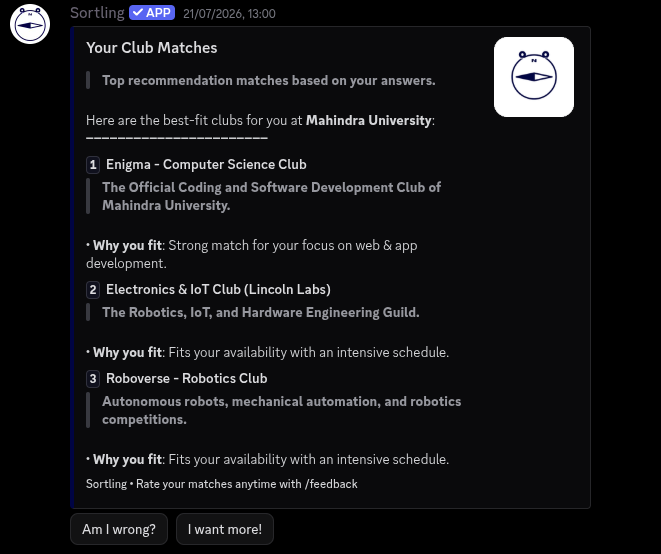
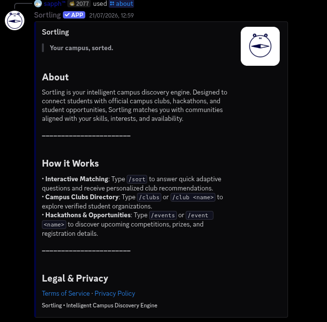
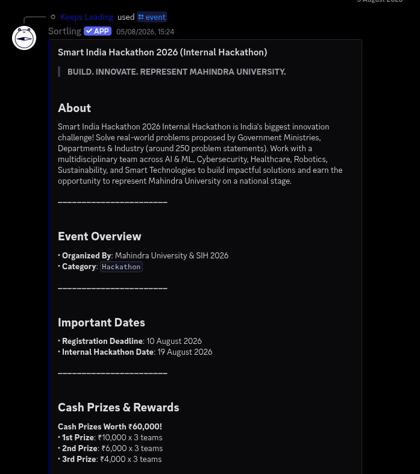

# Sortling

> An intelligent campus sorting engine and centralized club discovery platform.

## Team

**Team name:** No Name

### Members

- Arjun Rajindra: [@ArjunRajindra](https://github.com/ArjunRajindra)
- Sujay Sudhir: [@keepsloading](https://github.com/keepsloading)

### Team Roles & Journey
- **Sujay Sudhir:** Initially conceived, developed, and deployed the Discord bot prototype and core recommendation engine on the Mahindra University Discord server.
- **Arjun Rajindra:** Joined later to help expand and architect the broader web platform vision. Together, Arjun and Sujay are co-designing, building, and preparing to launch the full Sortling website.

## Problem

Extracurricular life at universities suffers from severe discovery paralysis and communication breakdown:

1. **Inbox Clutter & Alert Fatigue:** Student inboxes are overwhelmed by endless promotional emails from campus clubs. Because critical course notices get buried under club spam, students develop email fatigue and hesitate to open university mail altogether, missing both vital academic announcements and club recruitments.
2. **Choice Paralysis for Students:** Navigating 50+ clubs across tech, cultural, and sports domains is intimidating; especially for freshers who do not know where their skills, availability, and passions best align.
3. **The Real-World Bottleneck (Lessons from our Discord Prototype):** We deployed a Sortling prototype directly inside the **Mahindra University Discord server**. Students actively used the bot for recommendations, but maintaining the registry manually (updating events, revising club rosters, tracking dates) quickly became exhausting and unsustainable for a small team.

To scale, the platform needed to evolve beyond a bot into a centralized web platform that completely eliminates manual maintenance overhead.

## Solution

**Sortling** is a unified two-sided platform designed to connect students and clubs seamlessly through dedicated onboarding journeys, intelligent trait-vector matching, and an autonomous maintenance model.

---

### The Two-Sided Onboarding Journey

```
┌──────────────────────────────────────┐        ┌──────────────────────────────────────┐
│            CLUB ONBOARDING           │        │           STUDENT ONBOARDING         │
├──────────────────────────────────────┤        ├──────────────────────────────────────┤
│ 1. Create Verified Club Account      │        │ 1. Create Student Account            │
│ 2. Pre-Upload Club Profile:          │        │ 2. Take "Sorting Hat" Quiz:          │
│    • Domain & Focus Areas            │        │    • Passions & Creative Interests   │
│    • Detailed Club Description       │        │    • Work Style & Availability       │
│    • Meeting Cadence & Commitment    │        │ 3. Match Engine Evaluates Vectors:   │
│ 3. Trait Inferencer Converts Text    │───────►│    • Compares Responses with Club    │
│    into Numerical Trait Vectors      │        │      Trait Vectors Generated Above   │
│ 4. Club Unlocks Dashboard:           │        │ 4. Student Receives Top Matches:     │
│    • Post Recruitment & Openings     │        │    • Ranked Recommendations + Fits   │
│    • Publish 1-Click Events          │        │ 5. Student Unlocks Dashboard:        │
│    • Review Applicant Pipelines      │        │    • 1-Click Event Registrations     │
│                                      │        │    • Centralized Application Tracker │
└──────────────────────────────────────┘        └──────────────────────────────────────┘
```

#### 1. What Happens When a Club Joins (Club Onboarding)
- **Account Registration:** Club leadership creates an authenticated Club Account.
- **Profile & Data Pre-Upload:** The club pre-uploads its verified profile, including technical/cultural domains, executive contacts, meeting schedules, weekly time commitment, past projects, and recruitment prerequisites.
- **How Club Descriptions Power the Algorithm:** The text description, mission statement, and domain tags provided by the club are processed by Sortling's trait inference engine. The engine maps these descriptions into calibrated numerical **Club Trait Vectors** (e.g., `software`, `hardware`, `design_media`, `public_speaking`, commitment level). The richer and more descriptive a club's profile is, the more accurately the recommendation engine can route high-affinity students to that club.
- **Club Management Dashboard:** Once onboarded, clubs gain full administrative control to publish active recruitment notices, broadcast upcoming events, and manage their applicant pipeline directly without sending mass email blasts.

#### 2. What Happens When a Student Joins (Student Onboarding)
- **Account Registration:** The student creates a personalized Student Account.
- **The "Sorting Hat" Questionnaire:** The student enters an interactive questionnaire that asks adaptive questions about their passions, technical skills, creative interests, and weekly availability.
- **Dynamic Decision-Tree Matching:** Using Shannon entropy and information gain, the algorithm dynamically compares the student's answers against the pre-indexed **Club Trait Vectors** created during club onboarding.
- **Tailored Recommendations:** The student instantly receives their top-3 matched clubs with natural language "Why you fit" rationales, removing choice paralysis.
- **Student Dashboard & Application Tracker:**
  - **1-Click Event Registration:** Students can RSVP and register for hackathons and workshops directly without third-party forms.
  - **Application Tracker:** Students track the real-time status of all their club applications (applied, shortlisted, interview scheduled, accepted) in one centralized hub.
  - **Custom Notification Feed:** Students maintain a persistent feed of announcements from clubs they follow.

---

### Zero-Maintenance Operational Strategy (Plan A & Plan B)

To guarantee that the platform remains completely self-sustaining without the manual data-entry fatigue experienced in our initial prototype, Sortling operates with a dual-tier strategy:

```
                          ┌──────────────────────────────────────────────┐
                          │         Sortling Central Web Engine          │
                          │   (Student Portals + Recommendation Tree)    │
                          └──────────────────────┬───────────────────────┘
                                                 │
                   ┌─────────────────────────────┴─────────────────────────────┐
                   ▼                                                           ▼
         [ Plan A: Direct Buy-In ]                                   [ Plan B: Agentic Fallback ]
         Clubs onboard with dedicated accounts                       Autonomous AI Inbox Agent
         Full control to post, update & track                        Monitors & parses incoming club emails
                   │                                                           │
                   └──────────────────────► ◄──────────────────────────────────┘
                                 Zero Manual Maintenance
```

- **Plan A (Collaborative Two-Sided Ecosystem):**
  If clubs are convinced, they join as official **Club Accounts** through the onboarding flow detailed above. Clubs have complete autonomy over what they post, updating application processes, publishing event deadlines, and reviewing applicant pipelines directly.
- **Plan B (Autonomous AI Ingestion Fallback):**
  If clubs are slow or hesitant to adopt a new portal, an **Autonomous AI Agent** monitors incoming club broadcast emails and campus circulars. The agent automatically extracts dates, eligibility, and descriptions, feeds them through the trait inferencer, and populates the database engine autonomously. Interest matching and student application tracking still operate flawlessly.
- **Outcome:** Either way, the platform remains self-sustaining with **zero manual data-entry burden**.

---

### The Tested Proof-of-Concept (Discord Prototype)

Before designing the full web architecture, we built and battle-tested our core matching algorithms live on the **Mahindra University Discord server**:
- **Adaptive Matching Engine (`/sort`):** Verified multi-step interactive matching evaluating student traits against campus clubs.
- **Campus Directory (`/clubs`):** Searchable, paginated directory pre-loaded with 50+ verified Mahindra University organizations (including Enigma, Roboverse, Econova, and Lincoln Labs).
- **Event Registry (`/event`):** Live competition listings (e.g., Smart India Hackathon 2026) with prizes, timelines, and registration details.
- **Live Self-Training Engine:** An online gradient reinforcement loop (`TrainingService`) where student corrections via *"Am I wrong?"* dynamically recalibrate club trait vectors in real time.
- **Pre-Built REST API:** The prototype already hosts a Python REST API (`sorts/web/api.py`) exposing endpoints (`/api/university`, `/api/clubs`, `/api/sessions`) ready to power the web frontend.

## Technologies used

- **Backend & Core Engine:** Python 3.12, SQLAlchemy 2.0, SQLite / PostgreSQL
- **Prototype Client:** Nextcord (Discord Gateway & UI component views)
- **Matching Algorithm:** Shannon entropy decision tree & 4-tier cosine/dot-product trait vector scoring
- **Online Training:** Decayed gradient adjustment reinforcement loop
- **Data Validation & Parsing:** Pydantic v2, BeautifulSoup4
- **Hosting & Monitoring:** Render cloud web service

## How to run

### 1. Setup Environment

```bash
python3 -m venv .venv
source .venv/bin/activate
pip install -r requirements.txt
```

### 2. Configure Settings

```bash
cp .env.template .env
# Set DISCORD_TOKEN in .env (or run in CLI mode without Discord token)
```

### 3. Run the Interactive CLI Demo

Test the decision-tree sorting engine locally in your terminal without a Discord bot token:
```bash
python3 -m sorts.cli seed
python3 -m sorts.cli interactive --university-slug mahindra
```

### 4. Run the Prototype Bot & REST API Server

```bash
python3 main.py
```

## Demo

- **Repository Link:** [https://github.com/sortlingofficial/Discord](https://github.com/sortlingofficial/Discord)
- **Live Cloud Service:** [https://sortling-bot.onrender.com](https://sortling-bot.onrender.com) (Offline)

### Proof-of-Concept Screenshots (Tested at Mahindra University)

| 1. Verified Club Directory (`/clubs`) | 2. Adaptive Match Results (`/sort`) |
| :---: | :---: |
|  |  |
| *Browsing Mahindra University clubs with pagination* | *Decision-tree matches with tailored "Why you fit" rationales* |

| 3. Engine Overview & Architecture (`/about`) | 4. Live Event Hub & Registration (`/event`) |
| :---: | :---: |
|  |  |
| *Campus discovery engine explanation and command guide* | *SIH 2026 event details, prizes, dates, and registration* |

## Notes

- **From Bot to Web App:** Porting the vector engine into a full-stack web application with dedicated student portals and club officer dashboards.
- **Autonomous Inbox Agent Deployment:** Finalizing the automated email parsing agent for universities relying on legacy mail blasts.
- **Unified Student Application Tracker:** Allowing students to track all their club applications across departments in one clean dashboard.
